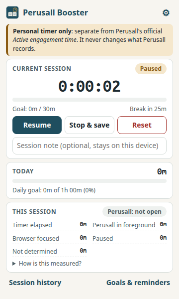

# Perusall Booster

A personal reading-session timer for students who read on [Perusall](https://perusall.com), for
**Google Chrome** and **Microsoft Edge** (Manifest V3).

> **Perusall Booster is not affiliated with Perusall.** Its timer is **your own personal record**. It is
> **separate from Perusall's official "Active engagement time"** and never reads, changes or sends anything
> that Perusall uses for grading. It does not simulate reading, and it never contacts Perusall's servers.

<p align="center"></p>

## Features

* **Personal timer**: start, pause, resume, stop & save, reset (with confirmation). Closing the popup never stops
  or double-counts the timer, because the background service worker owns it.
* **Activity indicators** for the current session:
  * *Timer elapsed*: time the timer was running.
  * *Perusall in foreground*: a Perusall tab was the active tab of the focused browser window.
  * *Browser focused*: some browser window had focus.
  * *Paused*: time you paused.
  * *Not determined*: the computer was asleep, the screen was locked, or the browser was closed. The timer pauses
    itself, and this time is never counted as reading.

  None of these prove that you were reading. They are transparency aids, not Perusall's numbers.
* **Goals and reminders**: target session length, daily goal, break reminders (pausing counts as a break),
  notification switches and a test notification.
* **Session history**: start/end, durations, note and completion status (*Completed* / *Ended early*). Delete one
  session, clear all, export CSV.
* **Today's total** with a progress bar towards your daily goal.
* **Private by design**: everything stays in your browser (`chrome.storage.local`). See [PRIVACY.md](PRIVACY.md).

## How the timer works

The timer stores *timestamps*, not a ticking counter. Each time anything happens (a button press, a tab
change, or a 30-second heartbeat alarm), the time since the previous observation is added to the bucket that
applied during it. Observing the same moment twice adds nothing, so time can't be counted twice. If no heartbeat
was seen for more than 90 seconds, or the browser was restarted, the gap is recorded as *not determined* and the
timer pauses at the last moment the browser was known to be running. Locking the screen also pauses it.

Perusall detection uses only the URL of the active tab, and the browser reveals that URL to the extension
**only for `app.perusall.com`**. There are no content scripts, so the extension never runs code inside Perusall
pages. Details are in [implementation-plan.md](implementation-plan.md).

## Install (unpacked)

### Option A: from a release ZIP

1. Build the ZIP (see below) or get `perusall-booster-<version>.zip`.
2. Extract it to a folder you will keep (for example `Documents/perusall-booster`).

### Option B: from source

```bash
npm install
npm run build          # writes the extension to dist/
```

### Google Chrome

1. Open `chrome://extensions`.
2. Turn on **Developer mode** (top right).
3. Click **Load unpacked** and select the `dist/` folder (or the extracted ZIP folder).
4. Pin **Perusall Booster** from the puzzle-piece menu.

### Microsoft Edge

1. Open `edge://extensions`.
2. Turn on **Developer mode** (left sidebar).
3. Click **Load unpacked** and select the `dist/` folder (or the extracted ZIP folder).
4. Click the puzzle-piece icon and use the eye icon to show **Perusall Booster** in the toolbar.

When installing, the browser asks for permission to *"Read and change your data on app.perusall.com"*. This is the
wording for host access. The extension uses it only to see whether the active tab is a Perusall page. It doesn't read
or change page content (see [PRIVACY.md](PRIVACY.md)).

## Build

| Command | Result |
|---|---|
| `npm run build` | development build in `dist/` (with source maps) |
| `npm run package` | production build in `dist/` + validation + `release/perusall-booster-<version>.zip` |

`dist/` and `release/` are build outputs and are not committed.

## Test

```bash
npm run check          # type check, lint, unit/integration tests, build, manifest validation, secret scan
npm run check:history  # secret / personal-data scan over the whole Git history
npm run test:browser   # real-browser tests in a throw-away Edge/Chrome profile (incl. a local mock of Perusall)
```

See [TESTING.md](TESTING.md) for the test matrix and results.

## Troubleshooting

| Problem | Fix |
|---|---|
| "Perusall: not detectable" | Site access was limited. In `chrome://extensions` / `edge://extensions` → Perusall Booster → *Details* → *Site access*, allow `app.perusall.com`. The timer itself still works. |
| No reminder notifications | Check the switches under **Goals & reminders**, use **Send a test notification**, and allow notifications for your browser in the operating system settings (and Focus / Do-not-disturb modes). |
| Timer shows "Paused (auto)" | The computer slept, the screen was locked or the browser was closed while the timer was running. Press **Resume** to continue. The gap is shown as *Not determined*. |
| Red banner about storage | The browser couldn't save data (for example, the disk is full). Free space and try again. Nothing already saved is deleted. |
| "Ended early" in history | The session was shorter than your target session length. Change the target in **Goals & reminders**. |
| Extension disappeared after a browser update | Unpacked extensions stay installed, but make sure the folder you loaded still exists. Load it again if you moved it. |
| `npm test` crashes with "Bus error" | You're on a filesystem where the `rolldown` native module can't be memory-mapped (for example NTFS via `ntfs3`). This project pins Vite 7 to avoid it, so run `npm install` again. |

## Known limitations

* The extension's numbers are **not** Perusall's numbers and can't predict a grade.
* Sleep detection has 30-second granularity (heartbeat alarm), and reminders can be up to 30 seconds late.
* Real OS suspend, Google Chrome (as opposed to Edge) and revoking site access in a real browser have not been
  verified in automated tests. See [TESTING.md](TESTING.md).
* Data lives in one browser profile. It doesn't sync between devices, and removing the extension deletes it (export a
  CSV first).

## Project structure

```
manifest.json            Manifest V3 (source; copied into dist/)
src/
  background/            service worker: timer owner, storage, activity context, reminders
    index.ts             chrome.* wiring and event listeners
    service.ts           BackgroundService (testable, no globals)
    storage.ts           validated chrome.storage.local access
    activity.ts          tab / window / screen-lock context
  popup/                 toolbar popup (HTML, CSS, controller)
  pages/                 history page and goals & reminders (options) page
  shared/                pure logic: timer engine, time helpers, model validation, CSV, reminders, settings
  styles/base.css        design tokens (light + dark), shared components
icons/                   PNG icons (generated by scripts/make-icons.mjs)
tests/                   Vitest unit and integration tests
scripts/                 build, package, manifest validation, secret scan, icon generator, browser tests
docs/                    screenshots
implementation-plan.md   design, permissions, storage, limitations
TESTING.md               how to test and the latest results
PRIVACY.md               what is stored and what is never collected
```

There is deliberately no `content/` folder: the extension runs no code inside web pages.

### Toolchain notes

* Vitest 4 runs on **Vite 7 (Rollup)**. Vite 8 uses the `rolldown` native module, which crashes with
  `SIGBUS` when loaded from an NTFS (`ntfs3`) drive.
* `.npmrc` sets `legacy-peer-deps=true`, because npm ≤ 10 crashes ("edgesOut") resolving Vitest 4's optional
  peers. The required peers are explicit dev dependencies.

## License

MIT. See [LICENSE](LICENSE).
